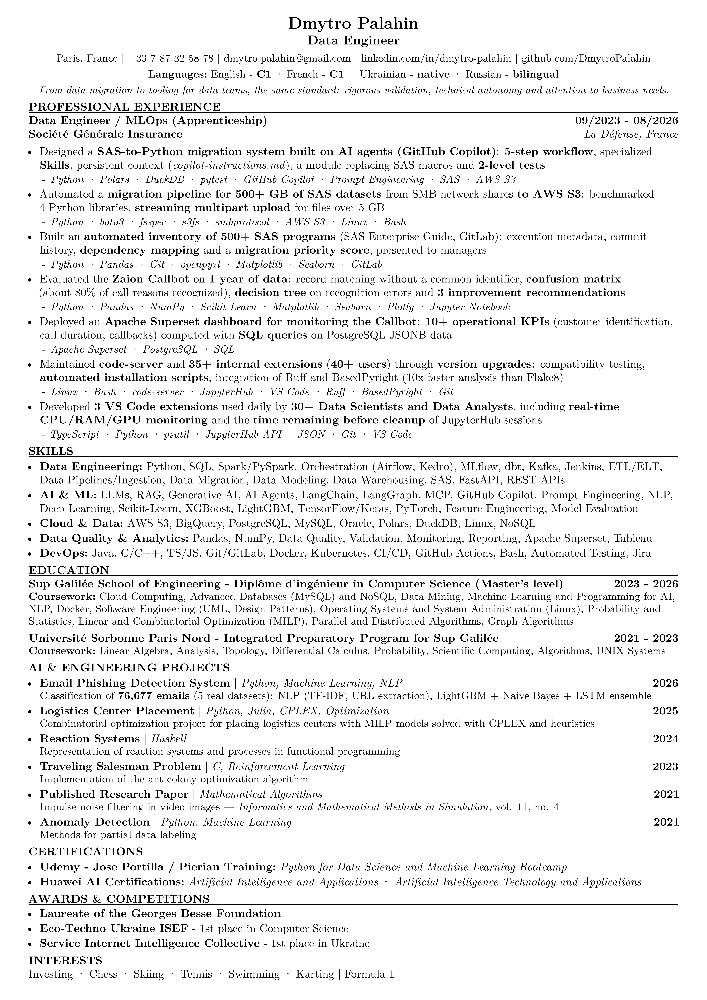
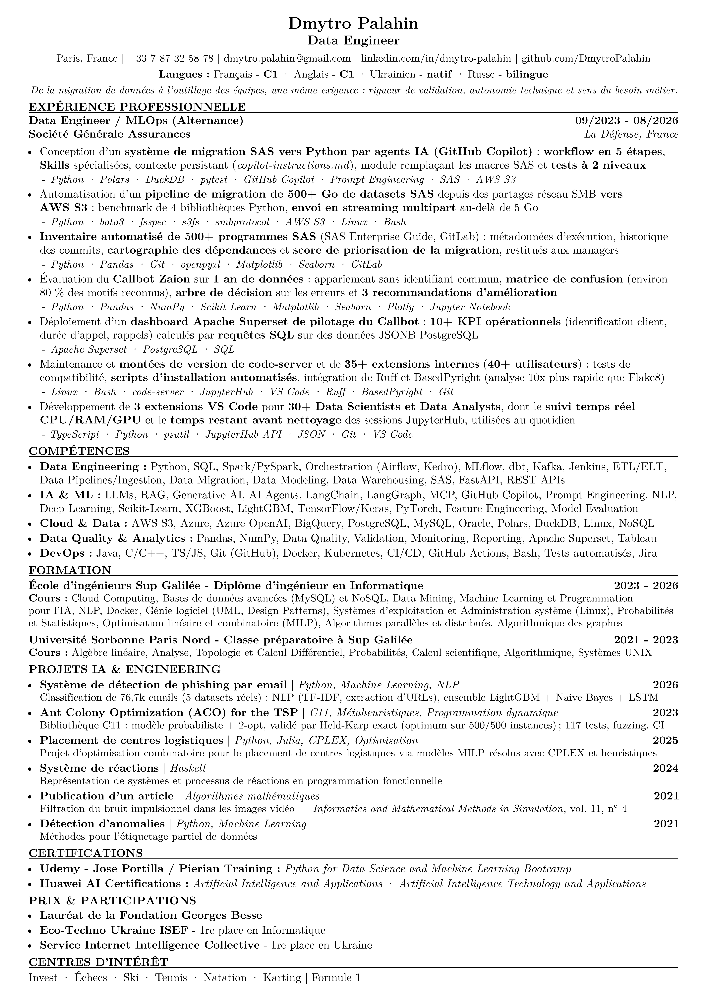

<div align="center">

# 📄 Dmytro Palahin

**Data Engineer · MLOps · AI Engineer**

Sup Galilée engineer (2026) · 3-year apprenticeship at Société Générale Assurances · Paris, France

[](https://github.com/DmytroPalahin/cv-latex/actions/workflows/latex.yml)
[](https://github.com/DmytroPalahin/cv-latex/releases/latest)
[](https://github.com/DmytroPalahin/cv-latex/commits/main)
[](https://www.latex-project.org/)


[](LICENSE)

[](https://www.linkedin.com/in/dmytro-palahin/)
[](https://github.com/DmytroPalahin)
[](mailto:dmytro.palahin@gmail.com)

[](https://github.com/DmytroPalahin/cv-latex/releases/latest/download/cv-dmytro-palahin-en-d.pdf)
[](https://github.com/DmytroPalahin/cv-latex/releases/latest/download/cv-dmytro-palahin-fr-d.pdf)

</div>

---

## 🖼️ Preview

<table>
  <tr>
    <th>🇬🇧 English · Data Engineer</th>
    <th>🇫🇷 Français · Data Engineer</th>
  </tr>
  <tr>
    <td><a href="src/en/cv-dmytro-palahin-en-d.pdf"></a></td>
    <td><a href="src/fr/cv-dmytro-palahin-fr-d.pdf"></a></td>
  </tr>
</table>

<sub>Click a preview to open the PDF.</sub>

---

## 👤 At a glance

| | |
| --- | --- |
| 💼 **Experience** | Data Engineer / MLOps (apprenticeship), Société Générale Assurances · 09/2023 – 08/2026 |
| 🎓 **Education** | Diplôme d'ingénieur in Computer Science (Master's level), Sup Galilée · 2023 – 2026 |
| 🛠️ **Core stack** | Python · SQL · AWS S3 · Polars · DuckDB · PostgreSQL · Apache Superset · GitHub Copilot (AI agents) |
| 🌍 **Languages** | English C1 · French C1 · Ukrainian (native) · Russian (bilingual) |

---

## 📥 Download

| Version | Language | PDF in the repository | Latest release |
| :---: | --- | --- | --- |
| `en-d` | 🇬🇧 English | [cv-dmytro-palahin-en-d.pdf](src/en/cv-dmytro-palahin-en-d.pdf) | [download](https://github.com/DmytroPalahin/cv-latex/releases/latest/download/cv-dmytro-palahin-en-d.pdf) |
| `fr-d` | 🇫🇷 Français | [cv-dmytro-palahin-fr-d.pdf](src/fr/cv-dmytro-palahin-fr-d.pdf) | [télécharger](https://github.com/DmytroPalahin/cv-latex/releases/latest/download/cv-dmytro-palahin-fr-d.pdf) |

All versions: **[Releases](https://github.com/DmytroPalahin/cv-latex/releases)**

---

## ✅ ATS-friendly by design

The template is built so that applicant tracking systems read the CV the way a recruiter does (checked with 10 PDF text extractors):

- **Single column**, no tables, no icons: text order = reading order
- Dates right-aligned with `\hfill` instead of `tabular`
- **ToUnicode map** (`\pdfgentounicode`): accents and symbols are extracted correctly
- **No fi/fl ligatures, no hyphenation**: no keyword is ever split
- `\B{...}` / `\I{...}` insert **real space glyphs** around bold and italic text, so parsers never glue words together
- **PDF metadata** (title, subject, keywords, language) set through `hyperref`
- LinkedIn and GitHub links shown in plain text

---

## 🏅 Certificates

- [Python for Data Science and Machine Learning Bootcamp](resources/docs/python_for_data_science_and_machine_learning_bootcamp.pdf) · Udemy, Jose Portilla / Pierian Training
- [Artificial Intelligence and Applications](resources/docs/huawei_artificial_intelligence_and_applications.pdf) · Huawei
- [Artificial Intelligence Technology and Applications](resources/docs/huawei_artificial_intelligence_technology_and_applications.pdf) · Huawei

---

## 📁 Project structure

```text
cv-latex/
├── .github/
│   └── workflows/
│       └── latex.yml                    # CI/CD: build the PDFs, release on tag
├── src/
│   ├── en/
│   │   ├── cv-dmytro-palahin-en-d.tex   # CV source (English)
│   │   └── cv-dmytro-palahin-en-d.pdf   # compiled CV
│   └── fr/
│       ├── cv-dmytro-palahin-fr-d.tex   # CV source (French)
│       └── cv-dmytro-palahin-fr-d.pdf   # compiled CV
├── resources/
│   ├── img/                             # README previews
│   └── docs/                            # certificates (PDF)
├── academic_profil/                     # academic programme 2021-2026 (EN / FR)
├── CHANGELOG.md
├── CONTRIBUTING.md
├── LICENSE
└── README.md
```

---

## ⚙️ Build locally

Requirements: **pdfLaTeX** with `latexmk`, from [TeX Live](https://www.tug.org/texlive/) / [MacTeX](https://www.tug.org/mactex/) 2021 or newer, or [MiKTeX](https://miktex.org/).

```sh
cd src/en
latexmk -pdf -auxdir=/tmp/latex-build -outdir=. cv-dmytro-palahin-en-d.tex
```

PDF to send, with a recruiter-friendly file name:

```sh
latexmk -pdf -jobname=CV_Dmytro_Palahin_Data_Engineer -auxdir=/tmp/latex-build -outdir=. cv-dmytro-palahin-en-d.tex
```

Regenerate the README preview (needs `pdftoppm` from Poppler: `brew install poppler`):

```sh
pdftoppm -png -r 200 -singlefile cv-dmytro-palahin-en-d.pdf ../../resources/img/cv-dmytro-palahin-en-d
```

The same commands work for French from `src/fr` with `fr-d` file names. More details in [CONTRIBUTING.md](CONTRIBUTING.md).

---

## 🚀 CI/CD

GitHub Actions ([`latex.yml`](.github/workflows/latex.yml)) compiles the English and French CVs in parallel whenever their sources or the workflow change, and publishes a release for every version tag. It can also be started by hand from the **Actions** tab.

```text
push / PR to main  ->  build EN + FR  ->  checks  ->  artifacts: PDF + PNG preview (30 days)
git tag v*.*.*     ->  build EN + FR  ->  checks  ->  GitHub Release: PDFs + previews, notes from CHANGELOG.md
```

| Check | Tool | Result |
| --- | --- | :---: |
| The CV fits on one page | `pdfinfo` | ❌ fails the build |
| Text is extractable: name, title, Python, SQL, GitHub link | `pdftotext` | ❌ fails the build |
| The committed PDF matches its `.tex` source | `pdftotext` | ⚠️ warning |

Create a release: add a `## [v2.0.0] - YYYY-MM-DD` section to [CHANGELOG.md](CHANGELOG.md), then

```sh
git tag v2.0.0
git push origin v2.0.0
```

---

## 🤝 Contributing

This is a personal CV repository: external contributions are not expected.
Feel free to **fork** it and adapt the template for your own CV, see [CONTRIBUTING.md](CONTRIBUTING.md).

## 📋 Changelog

All notable changes are listed in [CHANGELOG.md](CHANGELOG.md).

## 📜 License

[MIT](LICENSE): free to fork, adapt and reuse the template.
